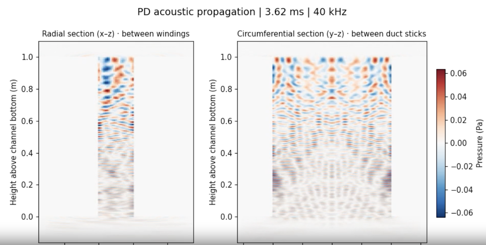
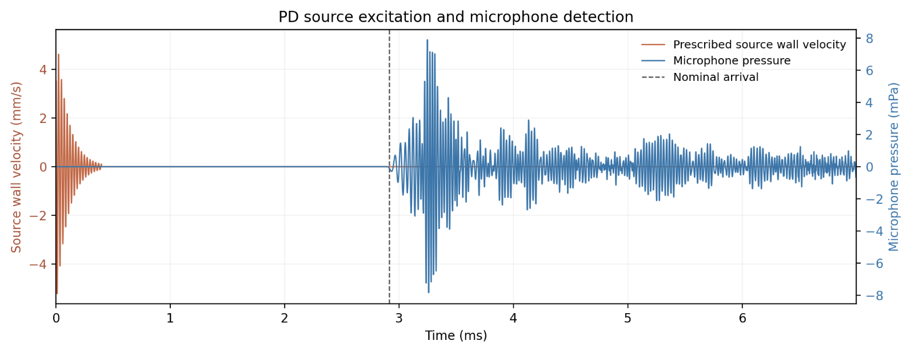

# PD Acoustic Propagation in an Air-Core Reactor

A GPU-accelerated 3D transient acoustic simulation of partial-discharge (PD)-like excitation in a cooling duct of a dry-type air-core reactor. The project models how an ultrasonic pressure disturbance travels along a narrow air channel, reflects from the duct walls, and reaches a microphone positioned below the reactor.

Built in **Python + PyTorch (CUDA)** using a staggered-grid **finite-difference time-domain (FDTD)** solver. The numerical model is three-dimensional; the presentation animation shows two orthogonal slices of the 3D pressure field.

> **Research prototype.** This is an idealized acoustic propagation and illustrative sensor-sensitivity study, not a calibrated PD charge (pC) measurement, validated reactor digital twin, or COMSOL model.

## Results preview

### Pressure-wave propagation



*Example frame from the 40 kHz transient simulation: radial (x–z) and circumferential (y–z) pressure sections. Red/blue indicate signed acoustic pressure (Pa). The two slices show the same 3D simulation, not separate 2D solves. This screenshot predates the final microphone-marker overlay.*

### Source excitation and microphone response



*Example 40 kHz run. Orange is the clean prescribed source wall-velocity signal (mm/s); blue is the microphone's simulated pressure (mPa). The dashed line indicates nominal acoustic arrival. Separate vertical scales are zero-aligned. The received signal includes reflections.*

The screenshots illustrate the visualization format; they should **not** be interpreted as the calibrated 20 kHz minimum-detectable PD case. Regenerate plots for each new run.

## Model overview

| Setting | Representative value |
|---|---|
| Duct height | 1.0 m |
| Radial gap (between windings) | 20 mm |
| Circumferential duct width (between duct sticks) | 100 mm |
| Source | Localized wall-normal velocity patch, 5 mm diameter |
| Excitation | Exponentially decaying sinusoid; 20 kHz study case, 100 µs decay time |
| Source position | z = 0.90 m |
| Microphone position | z = −0.10 m (1.00 m nominal separation) |
| Boundary treatment | Rigid lateral duct walls; open upper/lower air regions; outer numerical sponge |
| Spatial discretization | 1 mm in example commands; refinement required for quantitative confidence |

The prescribed source is a **velocity boundary condition**, not an acoustic pressure source or a specified discharge charge:

$$
v_n(t) = A e^{-t/\tau}\cos(2\pi f t), \qquad t \ge 0.
$$

The solver advances acoustic pressure and particle velocity through the 3D air domain. Pressure at a virtual microphone is recorded below the lower duct opening. Geometry and material boundaries are simplified and **not based on proprietary reactor drawings**.

## Installation

Requirements: Python 3.10+, an NVIDIA GPU and compatible CUDA-enabled PyTorch build for GPU runs, and FFmpeg (or the optional video encoder) for MP4 export.

```bash
python3 -m venv .venv
source .venv/bin/activate
python -m pip install --upgrade pip
```

Install the appropriate CUDA-enabled PyTorch version from [pytorch.org](https://pytorch.org/get-started/locally/), then:

```bash
pip install -r requirements.txt
pip install -e .
```

For video encoding, install `ffmpeg` or run `pip install -e '.[video]'`.

## Run a 20 kHz simulation

```bash
pd-acoustics-simulate \
  --device cuda:0 \
  --frequency 20000 \
  --dx-mm 1 \
  --source-z 0.90 \
  --mic-z -0.10 \
  --z-bottom -0.16 \
  --out results/20k_1m
```

The source amplitude defaults to **1 mm/s peak wall velocity**. Specify `--amplitude 0.004` to prescribe 4 mm/s instead. The nominal source-to-microphone distance is 1.00 m; the acoustic arrival and response depend on propagation and reflections.

### Illustrative sensitivity study

```bash
pd-acoustics-sensitivity \
  --input results/20k_1m \
  --noise-asd-upa 50 \
  --bandwidth-hz 1000 \
  --snr 5
```

This reports a linear amplitude scaling factor for a **peak-signal/RMS-noise criterion**. The assumed noise spectral density of 50 µPa/√Hz is **not verified at 20 kHz** (the cited microphone specification is at 1 kHz), so this is an illustrative threshold, not a manufacturer's guaranteed detection limit.

### Render waveform and animation

```bash
pd-acoustics-visualize \
  --input results/20k_1m \
  --view slices \
  --format mp4 \
  --amplitude-scale SCALE
```

Replace `SCALE` with the `amplitude_scale` printed by the sensitivity command. Omit the flag to show the original reference-amplitude simulation. The scaling assumes linear acoustics and does not rerun the FDTD solver.

The visualizer produces independent files for slide preparation, including `pressure_animation.mp4`, a pressure-slice preview, an orientation-key image, `waveforms.png`, and `microphone_zoom.png`.

## Repository structure

```text
src/pd_acoustics/
  simulate.py       3D pressure–velocity FDTD solver
  sensitivity.py    illustrative microphone sensitivity estimate
  visualize.py      2D slice animation and waveform plots
docs/
  model.md          modeling assumptions and numerical details
  images/           example screenshots for this README
tests/              automated smoke and plotting tests
```

## Interpretation and limitations

- A positive microphone signal demonstrates simulated **acoustic transmission**, not a minimum detectable PD charge in pC. Converting wall velocity to apparent discharge charge requires event-matched electroacoustic calibration.
- The rigid walls neglect epoxy compliance and coupled solid–fluid wave transmission. Air absorption, viscothermal losses, cooling flow, ambient background noise, and the microphone's frequency-dependent transfer function are not explicitly modeled.
- Numerical sponge boundaries are approximate absorbers, not perfectly matched layers. Quantitative predictions require spatial/time-step convergence and boundary-sensitivity studies.
- The microphone's assumed noise density and detection SNR are scenario parameters. No actual detection limit is established until the frequency-dependent sensor noise and processing bandwidth are verified.

## Related literature and standards

- X. Zhou *et al.*, “Study on insulation defect discharge features of dry-type reactor based on audible acoustic,” *AIP Advances*, 12, 025210 (2022). [DOI: 10.1063/5.0078735](https://doi.org/10.1063/5.0078735). Experimental acoustic measurements for reactor insulation defects; predominantly audible frequencies, **not** a 20 kHz source-velocity/pC calibration.
- B. B. Fonkou Kongne *et al.*, “Effect of sensor position on the measurement of acoustic wave produced by partial discharges,” *Heliyon*, 10, e25974 (2024). [DOI: 10.1016/j.heliyon.2024.e25974](https://doi.org/10.1016/j.heliyon.2024.e25974). Numerical study of propagation and sensor placement in an oil-filled transformer; different physical geometry from this air duct.
- **IEC 60270**: conventional electrical apparent-charge PD measurement; relevant to eventual pC calibration.
- **IEC TS 62478**: guidance on PD measurement using electromagnetic and acoustic methods; relevant to the broader monitoring concept.

Neither standard validates this solver or the illustrative microphone threshold.

## Development

```bash
pip install -r requirements-dev.txt
pip install -e .
pytest -q
```

See [model notes](docs/model.md) for further details. The repository is intended for engineering exploration and demonstration, not certified equipment assessment.
